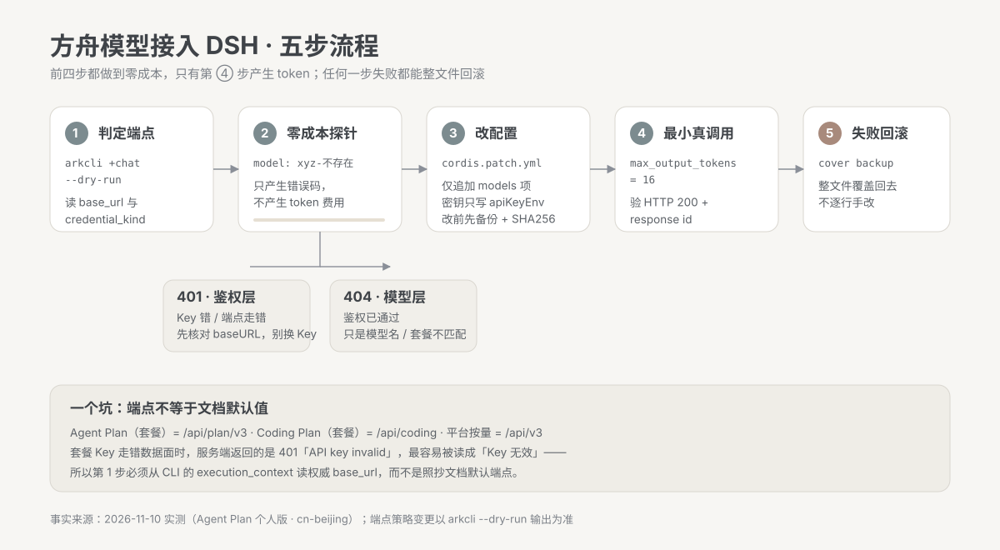
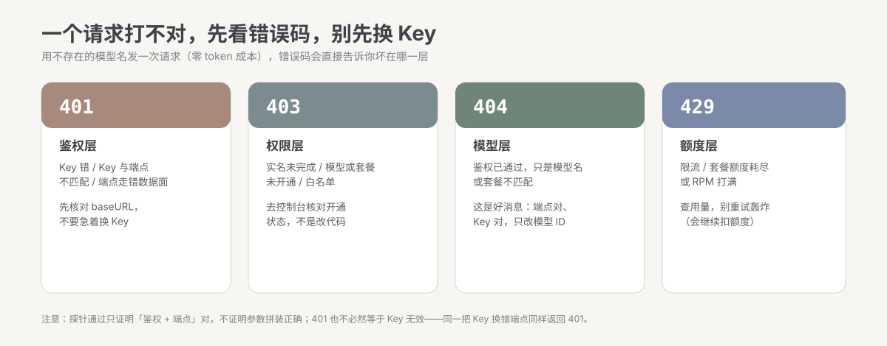
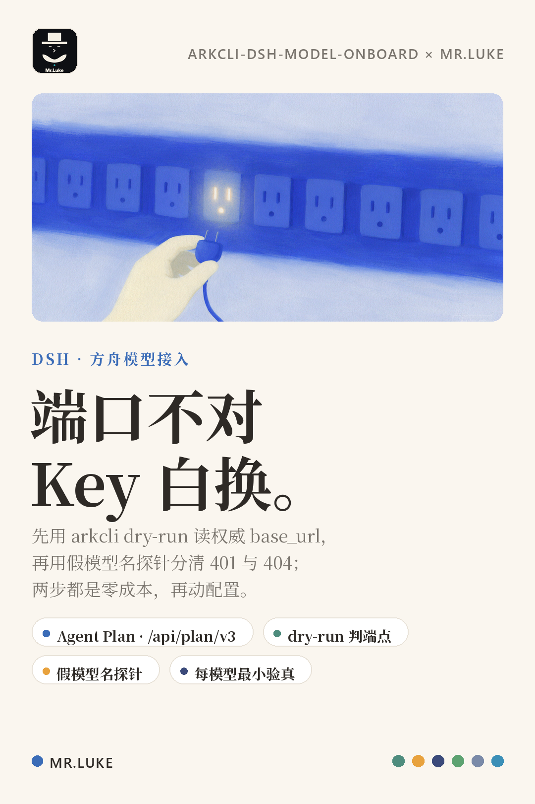

# arkcli-dsh-model-onboard

**把火山方舟的模型接进 DSH 模型选择器——先用零成本手段确认端点，再动配置。**



> 一个反直觉的事实：接入失败时最常见的误判不是「Key 错了」，而是**你打在了错误的数据面上**。同一个账号、同一把 Key，`/api/v3` 返回 401，`/api/plan/v3` 立刻 200——而 401 的报错文案永远写着「API key ... is missing or invalid」，于是人就去换 Key 了。

## 它解决什么

| 你遇到的问题 | 本 skill 的做法 |
|---|---|
| 选择器里根本没有「方舟」这一组，设置页却能看到 | 先查凭据引用：未配 Key 时模型目录会被静默过滤（不是配置没生效） |
| 调用报「API 密钥无效 / AUTH」 | 先用假模型名探针分清 401 / 403 / 404 / 429，别急着换 Key |
| 不知道套餐该用哪个 baseURL | 从 `arkcli +chat --dry-run` 的 `execution_context` 读权威值 |
| 加了一堆模型，不知道哪个真能用 | 每个模型做一次 `max_output_tokens=16` 的最小真实调用，记录 response id |
| 改配置改坏了想回去 | 改前备份 + SHA256，失败整文件覆盖回滚 |

## 什么时候用

- 要把新模型加进 DSH（DeepSeek Harness）模型选择器
- 已经配了 provider 但选择器里选不到
- 调用报 401 / AUTH / `API key invalid`
- 换了一家兼容 OpenAI / Anthropic 协议的网关，想知道该用哪个协议写配置

## 五步流程（每步都能独立验证）


1. **判定端点**（零成本）
   ```bash
   arkcli +chat --model <model-id> --dry-run --format json "hi"
   ```
   读 `summary.execution_context` 的 `base_url` 与 `credential_kind`。**以它为准，不要照抄文档默认端点。**

2. **零成本探针**（只产生错误码，不产生 token）
   ```bash
   curl -s -o out.json -w "HTTP=%{http_code}\n" -X POST "<base>/responses" \
     -H "Authorization: Bearer $ARK_API_KEY" -H "Content-Type: application/json" \
     --data-binary '{"model":"definitely-not-a-model-xyz","input":"hi"}'
   ```

3. **改配置**：只动 `cordis.patch.yml` 里 `llm-pi-ai` 的 `config.providers`（追加，不改既有行）

4. **最小真实调用验真**：`max_output_tokens=16`，确认 HTTP 200 + response id

5. **失败回滚**：整文件覆盖回备份，不逐行手改

## 错误码就是分层诊断



| 状态码 | 谁的问题 | 第一反应 |
|---|---|---|
| **401** | 鉴权层：Key 错 / Key 与端点不匹配 / 端点走错数据面 | 先核对 `baseURL`，不是换 Key |
| **403** | 权限层：实名 / 模型或套餐未开通 / 白名单 | 去控制台核对开通状态 |
| **404** / `UnsupportedModel` | 模型层：鉴权已通过，只是模型名或套餐不支持 | 好消息，只改模型 ID |
| **429** | 额度层：限流 / 额度耗尽 | 查用量，别重试轰炸 |

## 三个真实踩过的坑

**坑 1 · 没配 Key 的 provider 会静默消失。**
`dsh-llm-pi-ai` 的 `listModels()` 在解析不到凭据（`MISSING_CREDENTIAL`）时直接返回空数组，模型目录再把空组 `filter` 掉。表现就是：设置页有这一行，选择器里没有这一组，**而且不报任何错**。排查顺序永远是「凭据 → 选择器」，不是「重启」。

**坑 2 · 401 不等于 Key 无效。**
同一把套餐 Key 打在平台按量端点 `/api/v3` 上 → `401 AuthenticationError`；打在套餐端点 `/api/plan/v3` 上 → 鉴权通过。报错文案不会告诉你端点错了。

**坑 3 · 别名解析会让人以为模型不存在。**
请求 `deepseek-v4.1-flash`，返回里写 `deepseek-v4-1-flash-261017`——这是版本别名解析，正常。判断依据看 HTTP 状态与 response id，不看字符串是否逐字相等。

## 快速开始

```bash
# 1. 看当前账号有哪些文本模型
arkcli resources list --modality text --format json

# 2. 用 dry-run 确认端点与凭证切面（不花钱）
arkcli +chat --model doubao-seed-evolving --dry-run --format json "hi"

# 3. 探针：用一个不存在的模型名，确认鉴权路径是对的
PARA='{"model":"definitely-not-a-model-xyz","input":"hi"}'
curl -s -w "HTTP=%{http_code}\n" -X POST "https://ark.cn-beijing.volces.com/api/plan/v3/responses" \
  -H "Authorization: Bearer $ARK_API_KEY" -H "Content-Type: application/json" --data-binary "$PARA"

# 4. 备份 → 追加配置 → 校验 → 最小真实调用验真
```

配置片段见 [`examples/patch-snippet.yml`](examples/patch-snippet.yml)；dry-run 输出字段说明见 [`examples/dry-run.json`](examples/dry-run.json)；真实验真记录见 [`examples/verify-200.txt`](examples/verify-200.txt)。

## 端点对照（2026-11-10 实测）

| 通道 | baseURL | 协议 | 凭证 |
|---|---|---|---|
| Agent Plan（套餐） | `https://ark.cn-beijing.volces.com/api/plan/v3` | `openai-responses` | 套餐 Key |
| Coding Plan（套餐） | `https://ark.cn-beijing.volces.com/api/coding` | `anthropic-messages` | 套餐 Key |
| 平台按量 | `https://ark.cn-beijing.volces.com/api/v3` | `openai-completions` / `responses` | 按量 Key |

> 端点策略可能变化，判定的唯一权威来源是 `arkcli ... --dry-run` 的输出。

## 验收与回滚

| 项 | 判定 |
|---|---|
| 选择器出现该分组 | 刷新页面可见（新分组可能在列表下方） |
| 调用真的走对路由 | `~/.dsh/.dshw-usage.json` 里出现该 model 的 usage 事件 |
| 原 provider 未受影响 | 既有模型仍可选可调 |
| 回滚可用 | 备份文件可整文件覆盖回去 |

```powershell
Copy-Item ".\_backup\cordis.patch-before-xxx.yml" "$env:USERPROFILE\.dsh\profiles\desktop\cordis.patch.yml" -Force
```

## 边界（不要越界）

- 套餐 Key 不能跨数据面使用；套餐通常只有一把 Key，「新建专用 Key」未必可行
- `input` 只支持 `text` / `image`，TTS / ASR 是语音模型，不要加成文本模型
- 不要在 YAML 里写密钥明文，只写 `apiKeyEnv` 引用名
- 不要一次加几十个模型：按批加，每批逐个验真
- 401 不必然等于 Key 无效

## 文件结构

```
arkcli-dsh-model-onboard/
├── SKILL.md                     # 给 Agent 读的执行手册
├── assets/
│   ├── diagram.svg              # 五步流程示意图
│   ├── errors.svg               # 错误码分层图
│   └── poster.png               # 宣传海报（MR.LUKE 视觉）
├── examples/
│   ├── patch-snippet.yml        # 可直接套用的配置片段
│   ├── dry-run.json             # dry-run 输出字段说明
│   └── verify-200.txt           # 真实验真记录
└── LICENSE                      # MIT
```

## 关于



MR.LUKE · 制造业软件产品经理，用 agent 把重复的接入、排查、复盘做成可复用的流程。

- 许可：MIT
- 事实来源：2026-11-10 在 DSH + 火山方舟 Agent Plan（个人版 · cn-beijing）实测
